# SentinelRx – Adversarially-Robust & Privacy-Preserving Medication-Adherence ML

<div align="center">


**A Security-First Machine Learning Pipeline for Medication Adherence Prediction**

*Detects target leakage, evaluates adversarial attacks, protects patient privacy, and implements robust defense mechanisms for healthcare AI.*

</div>

---

# Project Overview

SentinelRx is an end-to-end Machine Learning security project focused on **medication adherence prediction** in healthcare.

Unlike traditional ML projects that only maximize prediction accuracy, SentinelRx prioritizes:

* Secure Machine Learning
* Privacy-Preserving AI
* Adversarial Robustness
* Model Explainability
* Data Integrity
* Healthcare AI Safety

The project demonstrates how real-world healthcare ML systems can be attacked and how modern defensive techniques mitigate those attacks.

---

# Features

✅ Dataset Integrity Audit

✅ Target Leakage Detection

✅ Leakage-Safe Feature Engineering

✅ Medication Adherence Prediction

✅ Model Benchmarking

* Logistic Regression
* Random Forest
* Histogram Gradient Boosting

✅ Model Calibration

✅ Explainable AI (Permutation Feature Importance)

✅ Adversarial Example Generation

✅ Membership Inference Attack

✅ Label-Flip Poisoning Attack

✅ Backdoor Attack Simulation

✅ Model Extraction Attack

✅ Randomized Smoothing Defense

✅ Differential Privacy (DP-SGD)

✅ Poisoning Detection

✅ Runtime Input Firewall (Mahalanobis OOD Detection)

---

# Project Structure

```text
SentinelRx/

│
├── SentinelRx.ipynb
├── README.md
├── requirements.txt
├── data/
│     ├── train.csv
│     └── test.csv
│
├── screenshots/
│     ├── 01_project_overview.png
│     ├── 02_environment_setup.png
│     ├── 03_dataset_statistics.png
│     ├── 04_target_leakage_detection.png
│     ├── 05_leakage_safe_pipeline.png
│     ├── 06_model_metrics.png
│     ├── 07_model_evaluation.png
│     ├── 08_feature_importance.png
│     ├── 09_top_features_table.png
│     ├── 10_adversarial_attack.png
│     ├── 11_membership_inference.png
│     ├── 12_membership_histogram.png
│     ├── 13_data_poisoning.png
│     ├── 14_model_extraction.png
│     ├── 15_red_team_scorecard.png
│     ├── 16_randomized_smoothing.png
│     ├── 17_dp_sgd_implementation.png
│     ├── 18_privacy_utility_frontier.png
│     ├── 19_poisoning_defense.png
│     └── 20_runtime_firewall.png
│
└── LICENSE
```

---

# Workflow

```text
Healthcare Dataset
        │
        ▼
Dataset Audit
        │
        ▼
Leakage Detection
        │
        ▼
Feature Engineering
        │
        ▼
Model Training
        │
        ▼
Model Evaluation
        │
        ▼
Explainability
        │
        ▼
Red Team Attacks
        │
        ▼
Blue Team Defenses
        │
        ▼
Secure Healthcare AI
```

---

# Technologies Used

* Python
* Jupyter Notebook
* NumPy
* Pandas
* Scikit-learn
* Matplotlib
* Seaborn

---

# Machine Learning Models

The project benchmarks multiple classifiers.

| Model                       | Purpose                |
| --------------------------- | ---------------------- |
| Logistic Regression         | Baseline Model         |
| Random Forest               | Ensemble Learning      |
| Histogram Gradient Boosting | Final Production Model |

---

# Security Evaluation

## Target Leakage Detection

The project identifies features that perfectly reconstruct the target label and removes them before model training.

---

## Explainable AI

Permutation Feature Importance is used to identify the most influential predictors affecting medication adherence.

---

## Red Team Attacks

The project evaluates multiple attacks against the deployed model.

* Adversarial Examples
* Membership Inference
* Label-Flip Poisoning
* Backdoor Injection
* Model Extraction

---

## Blue Team Defenses

To improve model robustness and privacy, the following defenses are implemented:

* Randomized Smoothing
* Differential Privacy
* Poisoning Sanitization
* Runtime Firewall

---

# Results

### Dataset Audit

* Duplicate detection
* Class distribution analysis
* Target leakage discovery

---

### Model Performance

* Cross Validation
* ROC-AUC
* Accuracy
* Precision
* Recall
* F1 Score

---

### Security Findings

* Target leakage detected and removed
* Adversarial attacks successfully evaluated
* Privacy attacks measured
* Multiple defenses significantly improved model robustness

---

# Screenshots

## Dataset Statistics

markdown
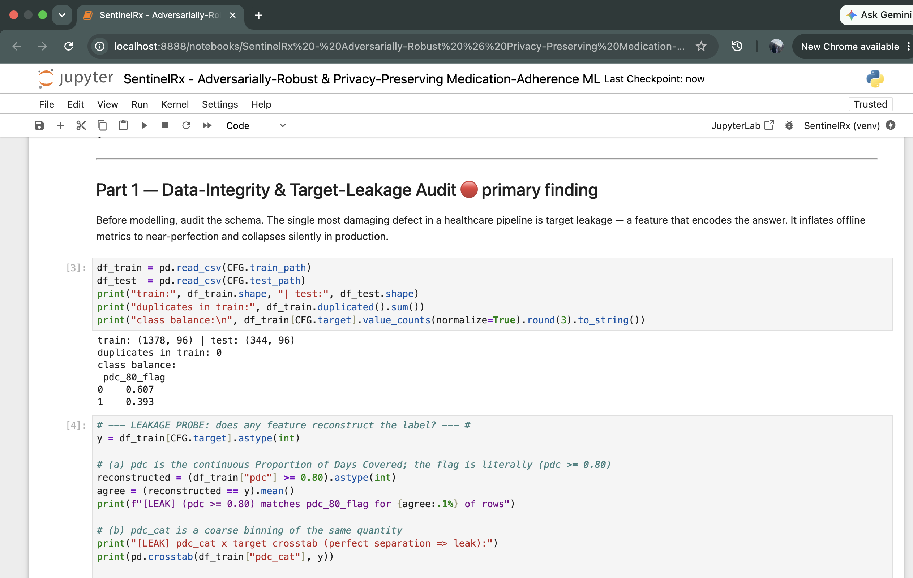


---

## Target Leakage Detection

markdown
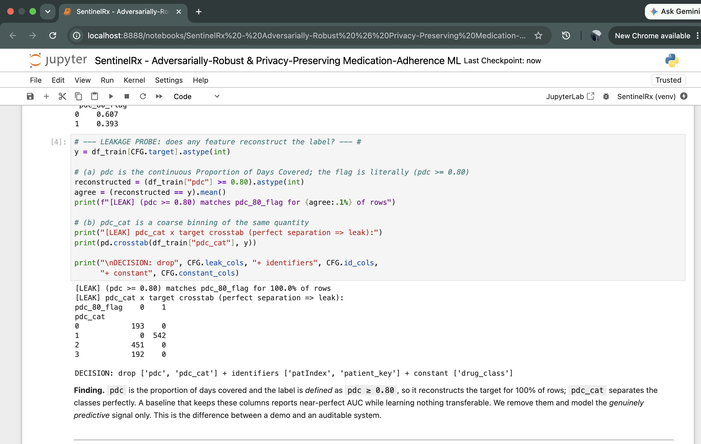


---

## Leakage Safe Pipeline

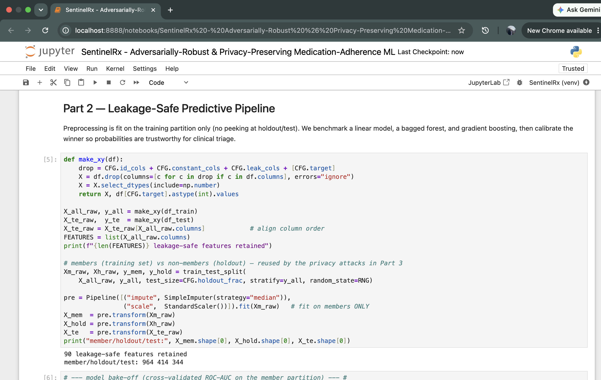

---

## Model Metrics

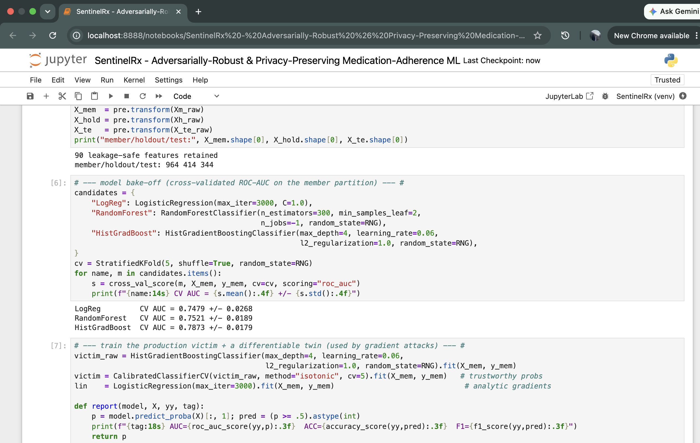

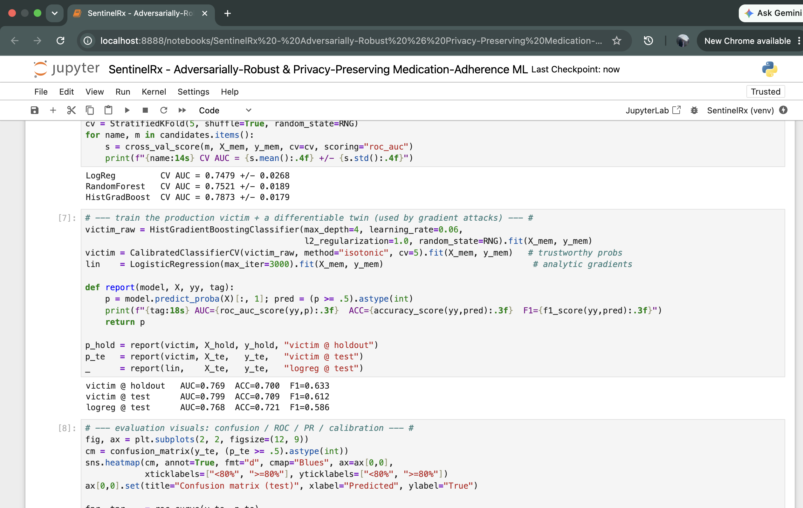

---

## Model Evaluation

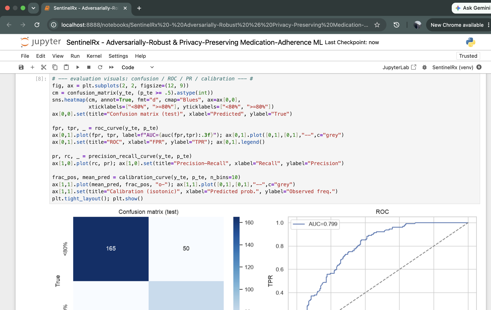

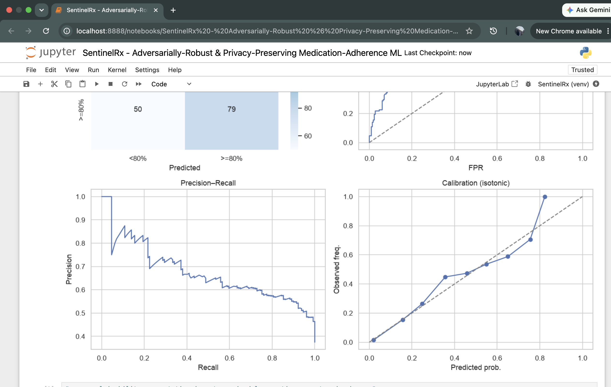

---

## Feature Importance

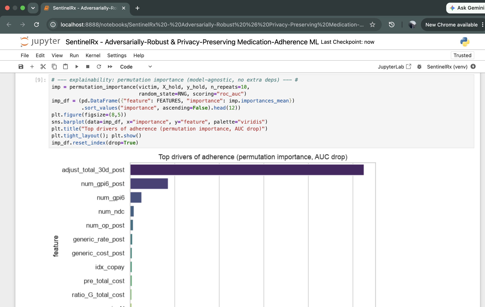


---

## Adversarial Attack

markdown
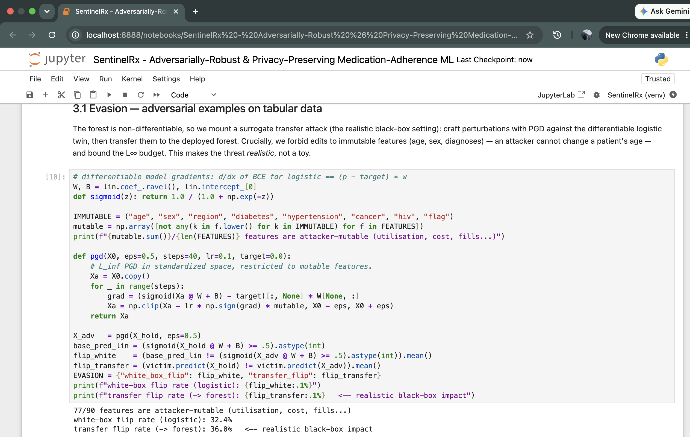


---

## Membership Inference

markdown
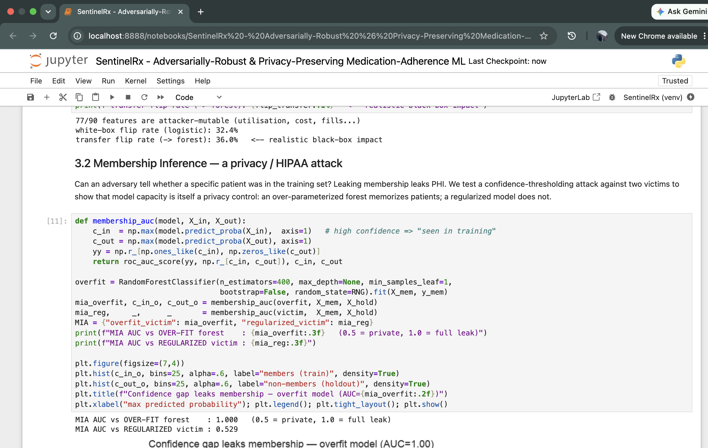


---

## Data Poisoning

markdown
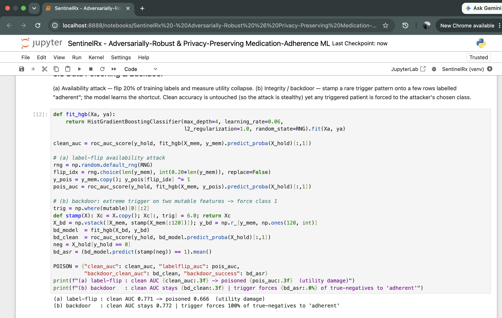


---

## Model Extraction

markdown
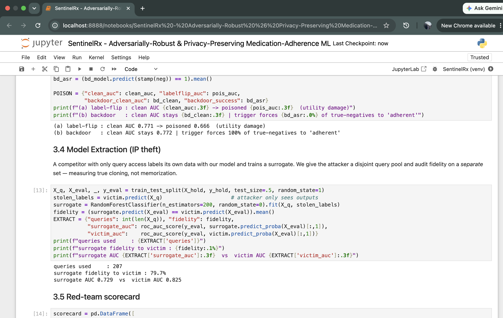


---


## Randomized Smoothing

markdown
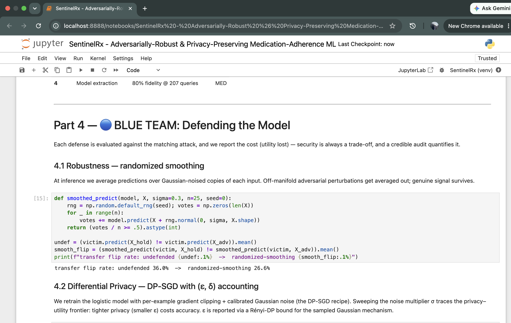


---

## Differential Privacy

markdown
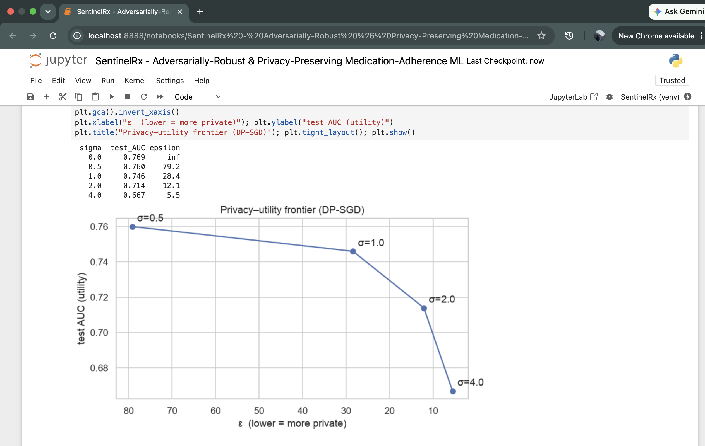


---

## Runtime Firewall

markdown
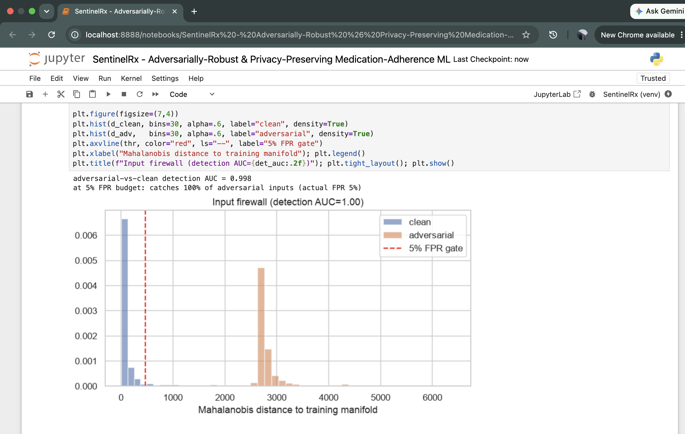


---

# Installation

Clone the repository.

```bash
git clone https://github.com/yourusername/SentinelRx.git
```

Move into the project directory.

```bash
cd SentinelRx
```

Install dependencies.

```bash
pip install -r requirements.txt
```

Launch Jupyter Notebook.

```bash
jupyter notebook
```

Open:

```text
SentinelRx.ipynb
```

Run all cells sequentially.

---

# Future Improvements

* Deep Learning Models
* Federated Learning
* Secure Multi-Party Computation
* Homomorphic Encryption
* SHAP Explainability
* Docker Deployment
* REST API Integration
* Cloud Deployment

---

# Learning Outcomes

This project demonstrates practical experience in:

* Machine Learning
* AI Security
* Adversarial Machine Learning
* Privacy-Preserving AI
* Explainable AI
* Differential Privacy
* Healthcare Analytics
* Secure Model Evaluation
* Data Science
* Python Development

---

# Author

**Greeshmita Bhogadi**

Computer Science Undergraduate

* Python
* Machine Learning
* AI Security
* Data Science
* Cloud Computing
* Privacy-Preserving AI

---

# License

This project is intended for educational and research purposes.

---

